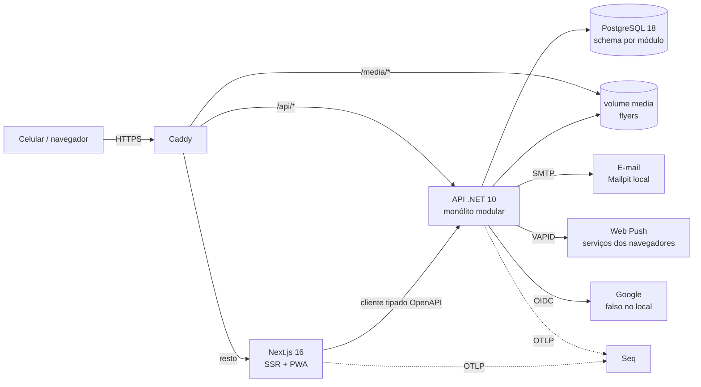

# Subsolo — mapa do sistema

> Documento vivo: o que roda onde, como sobe localmente, como chega em produção e qual ADR justifica cada escolha.
> Descreve o sistema como está hoje; o histórico fica nas specs (`docs/specs/`), nos ADRs (`docs/adr/`) e no
> `CHANGELOG.md`. Atualize no fechamento (G7) de toda spec que mudar um componente; `tools/sdd/spec_graph.py
> living-docs` mostra se algum ADR aceito ficou sem citação. O que cada pessoa faz no produto está no
> [guia de jornadas](jornadas.md).

## Visão geral

O Subsolo é a agenda de shows de metal underground por cidade, feita para o celular. Fãs veem a agenda, seguem
cidades, bandas e casas e recebem avisos; artistas e produtores aprovados cadastram shows; o admin cuida de cidades,
estilos, pedidos de perfil e denúncias.

Hoje o sistema roda só localmente. Produção (VPS, domínio, serviços reais) entra no go-live, SPEC-0003.

## Componentes por camada

### UI

- **Next.js 16** com TypeScript estrito, SSR das páginas públicas, metadados Open Graph por página e PWA instalável
  (manifest e service worker para o Web Push) — ADR-0013. Código em `web/`; páginas em `web/src/app/`
  (`(public)/` com a moldura do site, `admin/` com moldura própria), componentes em `web/src/components/`.
- Nenhuma regra de negócio no front: chama a API pelo cliente gerado do OpenAPI (`web/src/api/`, contrato em
  `docs/api/`) — ADR-0013.
- `web/src/proxy.ts` consulta a API antes da página para devolver 404/503 reais nas páginas públicas — ADR-0016.
- CSP estrita com nonce: as páginas são renderizadas por requisição — ADR-0017.
- Telas desenhadas no Stitch antes de implementar; design system em `docs/design/DESIGN.md`.

### Backend

- **Monólito modular em .NET 10 com vertical slices** — ADR-0001. Host em `src/Subsolo.Api`; módulos em
  `src/Modules/<Módulo>/` com as camadas `Domain`, `Application`, `Infrastructure` e `Presentation`; base comum em
  `src/Common/`.
- Módulos: `Users` (conta, sessão, link mágico e Google — ADR-0003), `Profiles` (bandas, casas, produtores e pedidos
  de perfil), `Events` (cidades, estilos, shows e agenda), `Engagement` (seguir, "vou", quem recebe cada aviso),
  `Notifications` (entrega por e-mail e Web Push — ADR-0014), `Moderation` (denúncias) e `Site` (apoie, apoiadores).
- Módulos só se falam por contratos públicos e eventos de integração com outbox; as regras de dependência são
  testadas em `tests/Subsolo.ArchitectureTests` — ADR-0001.
- Flyers: NetVips gera as variantes `thumb`, `full` e `og`, gravadas por hash do conteúdo atrás de `IFileStorage`
  — ADR-0015.
- Segurança: rate limit, CSRF nos endpoints que mudam estado, sessão em cookie `__Host-` — ADR-0003.

### Dados

- **PostgreSQL 18 + EF Core 10 (Npgsql)**, um schema e um histórico de migrações por módulo; datas em UTC com o fuso
  da cidade — ADR-0002. Migrações em `src/Modules/<M>/<...>.Infrastructure/Migrations`.
- Flyers no volume `media`, servidos pelo Caddy com cache imutável — ADR-0015.
- Dados pessoais, finalidade, base legal e retenção conforme a LGPD — ADR-0008.
- Backup diário (`pg_dump` + flyers, com restic para o Cloudflare R2) e teste mensal de restauração — ADR-0011,
  implantados no go-live.

### Infraestrutura

- **Aspire 13.6** é o modelo único da aplicação: o `src/Subsolo.AppHost` sobe tudo no `aspire run` e gera o
  Docker Compose de deploy (`aspire publish`) — ADR-0004.
- **Caddy** na frente de tudo: `/api/*` → API, `/media/*` → flyers, o resto → Next.js; mesmo domínio, sem CORS —
  ADR-0004.
- Produção prevista: uma VPS com staging e produção como projetos Compose separados — ADR-0004, sem custo antes do
  go-live — ADR-0012.

### Entrega

- Toda mudança entra por pull request na `main`, com checks obrigatórios e merge commit — ADR-0007.
- Qualidade automática: avisos como erro, `dotnet format`, ESLint, Prettier, `tsc`, Semgrep e CodeQL — ADR-0006.
- Dependências fixadas (NuGet central com lockfile, `pnpm-lock.yaml`, imagens com versão) e Dependabot semanal —
  ADR-0009.

### Observabilidade

- OpenTelemetry na API (ServiceDefaults do Aspire) e no Next.js, enviando logs e traces ao **Seq**; health checks e
  monitor externo no go-live — ADR-0010. Runbooks dos alertas em `docs/runbooks/`.

### Testes

- xUnit v3 + Testcontainers (PostgreSQL real), Vitest no front e Playwright para as jornadas no celular (mobile-chrome,
  mobile-safari e desktop-chrome) — ADR-0005. Guia em `tests/README.md`; E2E em `e2e/tests/`, marcados com
  `[jornada: <id>]`.

## Serviços externos

| Serviço | Para quê | Autenticação | Se cair | Nos testes e no local |
|---|---|---|---|---|
| E-mail (SMTP) | link mágico, resumo diário, lembrete | usuário e senha SMTP, segredo | entrada pelo Google continua; avisos ficam na fila e são reenviados | Mailpit |
| Web Push | aviso de show novo e lembrete | chaves VAPID, segredo | só o e-mail chega | chaves geradas pelo AppHost |
| Google (OIDC) | entrar com Google | cliente OAuth, segredo | entrada pelo link mágico continua | `mock-oauth2-server` |
| Cloudflare R2 | backup (go-live) | chave de acesso, segredo | backup do dia falha e gera alerta | — |

## Ambientes

- **Local (`aspire run`):** PostgreSQL, Seq, Mailpit, Google falso, API, Next.js (`next dev`) e Caddy em
  https://localhost:8443. Segredos de desenvolvimento gerados pelo AppHost ou nos `dotnet user-secrets`; opções do
  run como `Subsolo:PublicUrl` e `Subsolo:AdminEmail`.
- **Local pelo celular:** `./tools/tunnel.sh --run` abre um túnel do Cloudflare e sobe o AppHost com o endereço dele.
- **Pilha do Compose (`./tools/compose-up.sh`):** o Compose gerado pelo `aspire publish`, com as imagens de produção,
  usado pelo E2E local e no CI.
- **Staging e produção:** ainda não existem (SPEC-0003). Os segredos virão dos environments do GitHub Actions,
  gravados num `.env` por ambiente na VPS — ADR-0008.

## Rodar localmente

Pré-requisitos e comandos completos no [README](../README.md#como-rodar): .NET 10, Node 24 com pnpm, Docker e a
Aspire CLI. Em resumo:

1. `aspire run` na raiz e abrir https://localhost:8443.
2. Testes: os comandos oficiais estão em `docs/specs/sdd-config.yml` (`build`, `test`, `test_integration`, `test_e2e`,
   `arch_test`); `./tools/lint.sh` roda o lint.

## Caminho até produção

1. Spec aprovada, testes antes do código e revisão independente (processo SDD em `docs/specs/`).
2. PR na `main` com os jobs do CI (`.github/workflows/ci.yml`): `build`, `lint`, `test`, `integration`, `e2e`,
   `security`, `codeql` e `sdd` — ADR-0007.
3. Deploy (go-live, SPEC-0003): o GitHub Actions monta as imagens, roda as migrações como bundle antes da troca de
   versão e sobe o Compose na VPS, primeiro em staging; produção só com confirmação do Thomas — ADR-0002, ADR-0004.
4. Depois do deploy: smoke e E2E contra o ambiente; rollback pela tag anterior.

## Decisões

| ADR | Onde aparece no sistema |
|---|---|
| ADR-0001 | `src/Modules/*` em camadas, regras em `tests/Subsolo.ArchitectureTests` |
| ADR-0002 | PostgreSQL com um schema e um histórico de migrações por módulo |
| ADR-0003 | módulo `Users`: link mágico, Google e sessão em cookie `__Host-` |
| ADR-0004 | `src/Subsolo.AppHost` (run e publish) e o Caddy na frente |
| ADR-0005 | xUnit + Testcontainers, Vitest e Playwright no CI |
| ADR-0006 | `Directory.Build.props`, `.editorconfig`, `./tools/lint.sh`, Semgrep e CodeQL |
| ADR-0007 | PR obrigatório na `main` com os checks do CI |
| ADR-0008 | user-secrets no local, environments do GitHub na produção, regras de LGPD |
| ADR-0009 | `Directory.Packages.props`, lockfiles, imagens com versão e Dependabot |
| ADR-0010 | OpenTelemetry → Seq e runbooks em `docs/runbooks/` |
| ADR-0011 | backup e teste de restauração (go-live) |
| ADR-0012 | tudo local e gratuito até o go-live |
| ADR-0013 | `web/` em Next.js 16 com cliente tipado da API |
| ADR-0014 | módulos `Engagement` (quem recebe) e `Notifications` (canais e-mail e Web Push) |
| ADR-0015 | flyers com NetVips, `IFileStorage` e `/media` com cache imutável |
| ADR-0016 | `web/src/proxy.ts` com status HTTP real nas páginas públicas |
| ADR-0017 | CSP com nonce e páginas renderizadas por requisição |
