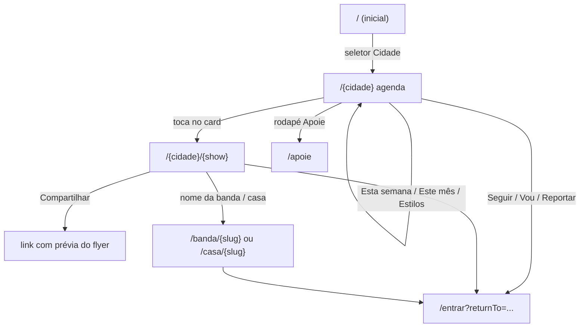
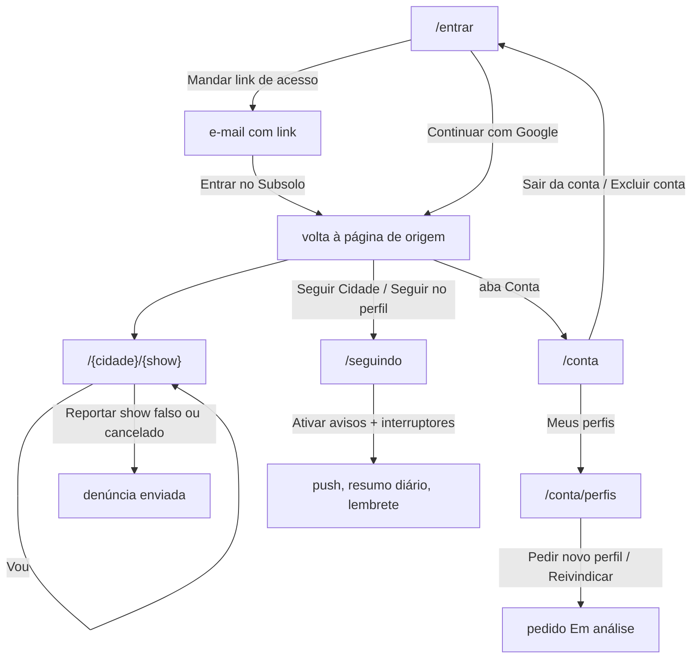
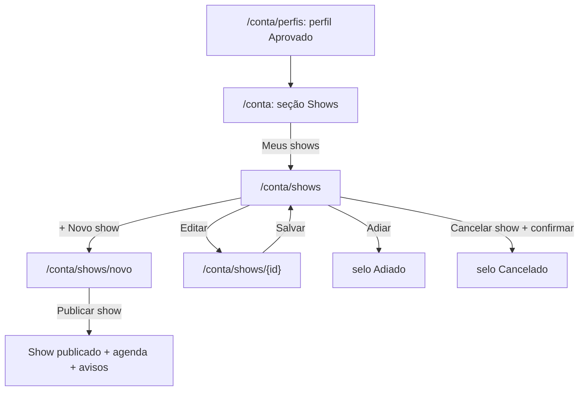
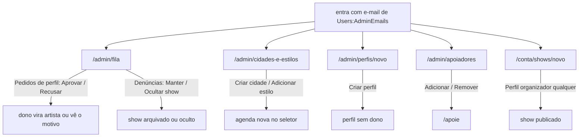

# Subsolo — guia de jornadas por perfil

> O que cada tipo de pessoa faz no Subsolo, passo a passo, e como reproduzir cada jornada na sua máquina. Fonte: o
> código e as specs em `docs/specs/` (atualizado em 2026-10-26).

## 1. O que é o Subsolo

Agenda de shows de metal underground por cidade. Bandas, casas e produtores com perfil aprovado cadastram os shows;
o fã abre a agenda da cidade, marca "Vou", segue cidades, bandas e casas e recebe aviso de show novo e lembrete na
véspera. Gratuito para todos e sem anúncios. Funciona no navegador (celular primeiro); não há app nas lojas.
Visão completa na [SPEC-0002](../docs/specs/SPEC-0002-agenda-subsolo-lancamento-mvp.md).

### Glossário

| Termo | O que é no sistema |
|---|---|
| Cidade | Unidade da agenda. Tem nome, UF, fuso e endereço (slug) na URL: `/cidade-exemplo`. Só o admin cria. |
| Estilo | Gênero musical (death, black, grind, doom, thrash…). Catálogo mantido pelo admin; filtra a agenda e marca shows e bandas. |
| Perfil | Página de uma **banda** (`/banda/{slug}`), **casa** ("Casa / Local", `/casa/{slug}`) ou **produtor** (`/produtor/{slug}`). Pode ter dono (quem pediu e foi aprovado) ou estar "sem dono" (criado pelo admin). |
| Artista | Papel (`artist`) de quem tem ao menos um perfil aprovado. É o que libera o cadastro de shows. |
| Show | Evento com flyer, nome, data e horário, casa, cidade, line-up, estilos, preço e link do ingresso. Página em `/{cidade}/{slug}`. Pode estar cancelado ("Cancelado") ou adiado ("Adiado"). |
| "Vou" | Marcação do fã logado num show. A contagem "{n} vão" é pública; quem vai nunca aparece. |
| Seguir | O fã logado segue uma cidade, banda, casa ou produtor. A lista fica em `/seguindo`. |
| Aviso | Push no aparelho quando sai um show novo de quem você segue (ativado em `/seguindo`, região "Avisos"). |
| Resumo diário | E-mail às 9h (America/Sao_Paulo) com os shows novos de quem você segue. Opcional. |
| Lembrete | "Amanhã: …" na véspera do show em que você marcou "Vou", por push e/ou e-mail, a partir das 10h no fuso da cidade. |
| Denúncia | O fã logado reporta um show (falso, cancelado sem aviso, informação errada, outro). Até 10 por dia. |
| Moderação | O admin decide cada show denunciado: "Manter" ou "Ocultar show". O oculto some da agenda, das páginas e dos avisos. |
| Apoie | Página `/apoie` com o Pix do projeto e a lista de apoiadores. |

## 2. Perfis de usuário

| Perfil | O que pode fazer | Como alguém vira |
|---|---|---|
| **Visitante** (anônimo) | Ver a agenda de qualquer cidade, filtrar, abrir a página do show e compartilhar, ver perfis públicos, ver `/apoie`, `/privacidade`, `/termos`. Tocar em "Seguir", "Vou", "Reportar…" ou abrir `/seguindo` e `/conta` leva a `/entrar` com a volta para a página de origem. | Ninguém precisa fazer nada. |
| **Fã** (logado, papel `fan`) | Tudo do visitante, mais: "Vou", seguir, aba "Seguindo", avisos e e-mails, denunciar show, "Minha conta" (nome, baixar dados, excluir conta, sair), pedir ou reivindicar um perfil. | Entrar em `/entrar` pelo link mágico no e-mail ou por "Continuar com Google". O primeiro acesso cria a conta. |
| **Artista** (papel `artist`, perfil aprovado) | Tudo do fã, mais: "Meus shows" (`/conta/shows`) para cadastrar, editar, adiar e cancelar shows dos próprios perfis. | Pedir um perfil novo ou reivindicar um sem dono em `/conta/perfis`; o admin aprova na fila. O papel vale assim que a aprovação é processada. |
| **Admin** (papel `admin`) | Painel em `/admin/*`: fila de pedidos de perfil e de denúncias, perfil sem dono, cidades e estilos, apoiadores. Cadastra shows em qualquer perfil. | O e-mail precisa estar na configuração `Users:AdminEmails` (variável `Users__AdminEmails__0`). O papel é aplicado ao entrar; se o e-mail sai da lista, o papel sai na entrada seguinte. Localmente, ver a seção 4. |

Observações:

- Não há link do site público para o painel do admin: o admin digita `/admin/fila` (ou outra página do painel).
  Dentro do painel, o menu tem "Fila", "Novo perfil", "Cidades e estilos" e "Apoiadores".
- No celular a navegação fica embaixo (abas "Agenda", "Seguindo", "Apoie", "Conta"); no desktop, no cabeçalho
  ("Agenda", "Seguindo", "Apoie" e "Entrar" ou "Conta"). O cabeçalho tem o seletor "Cidade" quando há cidades.
  O rodapé tem "Apoie", "Instagram" e "Privacidade".

## 3. Jornadas por perfil

### 3.1 Visitante

**Ver a agenda da cidade**

1. Abre `/{cidade}` (ex.: `/cidade-exemplo`), por link direto ou pelo seletor "Cidade" do cabeçalho.
   Hoje a página inicial `/` mostra só "Agenda de shows de metal underground por cidade. Em construção.", sem
   cabeçalho nem navegação. `/` passa a ter a moldura do site: cabeçalho com o seletor
   de cidade, rodapé e navegação inferior; no celular a aba "Conta" leva a `/entrar`.
2. Vê "Agenda {Cidade}", o resumo ("PRÓXIMOS 90 DIAS · n shows") e os cards (flyer, data no fuso da cidade, casa,
   line-up, estilos, selo "Cancelado"/"Adiado", "{n} vão").
3. Filtros: "Esta semana", "Este mês", "Escolher data" (campos "De" e "Até") e os chips de "Estilos". A URL guarda o
   filtro: `/cidade-exemplo?periodo=semana&estilo=death`, `periodo=mes`, `de`/`ate` em aaaa-mm-dd.
4. No fim da agenda, "Produzindo show em {Cidade}?" com o link "Cadastrar evento na agenda" (`/conta/shows/novo`;
   sem sessão, passa por `/entrar`).

O que pode dar errado:

- Filtro sem resultado: "Nenhum show com esses filtros." e o link "Limpar filtros".
- Cidade sem show: "Nenhum show anunciado ainda em {Cidade}." / "Os shows aparecem aqui assim que forem anunciados."
- Cidade inexistente: 404 com "Cidade não encontrada" / "Ainda não temos agenda para essa cidade." e "Voltar para o início".
- API fora do ar: 503 com "Agenda indisponível" / "A agenda está fora do ar por alguns instantes. Tente de novo."

**Abrir o show e compartilhar**

1. Toca no card: abre `/{cidade}/{slug}` com o flyer inteiro, data e horário, "Entrada"/"Ingresso", line-up e casa.
2. "Compartilhar": no celular abre o compartilhamento do sistema (Web Share); sem ele, copia o link e anuncia
   "Link copiado.". O link leva prévia Open Graph com o flyer (1200×630).
3. Nome da banda leva a `/banda/{slug}`; nome da casa, a `/casa/{slug}`. "Agenda {Cidade}" volta à agenda.
4. No perfil público: tipo e cidade, nome, "Seguir" com "{n} seguidores", estilos, redes (Instagram, Bandcamp,
   Metal Archives), próximos shows e shows passados ("Nenhum show passado.").

O que pode dar errado: show inexistente → 404 "Show não encontrado" com "Ver a agenda de {Cidade}"; perfil
inexistente → 404 "Perfil não encontrado" com "Voltar para o início"; API fora do ar → "Show indisponível" /
"Perfil indisponível".

**Apoie e páginas institucionais**: `/apoie` ("Apoie o Subsolo", QR e "Chave Pix" com "Copiar chave" → "Chave
copiada."; sem chave configurada: "O Pix do Subsolo chega em breve."; lista "Apoiadores" ou "Seja o primeiro a
apoiar."), `/privacidade`, `/termos`.

**Ações que pedem login**: "Seguir", "Vou", "Reportar show falso ou cancelado" e as abas "Seguindo"/"Conta" levam a
`/entrar?returnTo=…`; depois de entrar, o fã volta para a mesma página.

### 3.2 Fã (logado)

**Entrar e sair**

1. `/entrar`: "Digite seu e-mail e mandamos um link para você entrar no Subsolo." Campo "Seu e-mail", botão "Mandar
   link de acesso" ("Sem senha: o link vale por 15 minutos."). Acima, "Continuar com Google" quando o Google está
   ligado.
2. Tela "Confira seu e-mail": o link vale 15 minutos e só uma vez; "Reenviar em 0:59" vira "Reenviar link";
   "Usar outro e-mail".
3. O link do e-mail abre `/entrar/confirmar`; o botão "Entrar no Subsolo" cria a sessão e volta para a página de
   origem (`returnTo`). A primeira entrada cria a conta com o papel `fan`.
4. Sair: `/conta` → seção "Sessão atual" → "Sair da conta". Vai para `/entrar`; voltar no navegador não reabre a conta.
   A sessão vale 30 dias sem uso e no máximo 90 dias.

O que pode dar errado: "Digite um e-mail válido."; "Muitas tentativas. Espere um minuto e tente de novo.";
"Não conseguimos mandar o e-mail agora. Tente de novo em alguns minutos." (SMTP fora do ar); link expirado ou
usado: "Link inválido" / "Este link expirou ou já foi usado." com "Pedir outro link"; Google: "Não deu para entrar
com o Google. Tente de novo ou use o link por e-mail." e "Sua conta Google não tem e-mail verificado. Use o link
por e-mail.".

**Vou**: na página do show, "Vou" vira "Vou ✓" e a contagem "{n} vão" muda (anúncio "Você marcou que vai a
{show}."). Tocar de novo desmarca. Show cancelado não tem o botão. Erro: "Não foi possível marcar agora. Tente de
novo em instantes."

**Seguir**: na agenda, "Seguir {Cidade}"; no perfil, "Seguir". O botão vira "Seguindo" ("Você agora segue
{nome}."). A aba "Seguindo" (`/seguindo`) lista "Cidades", "Bandas", "Casas" e "Produtores", cada item com
"Deixar de seguir". Vazio: "Você ainda não segue ninguém. Siga sua cidade na agenda e as bandas e casas nos
perfis." Erros: "Não foi possível mudar agora…", "Não foi possível carregar o que você segue agora…".

**Avisos, resumo e lembrete** (em `/seguindo`, região "Avisos")

1. "Avisos no celular (push)" → "Ativar avisos" pede a permissão do navegador; com sucesso: "Avisos ativos neste
   aparelho".
2. Interruptores: "Show novo de quem eu sigo (na hora)", "Resumo diário por e-mail", "Lembrete na véspera (no
   celular)", "Lembrete na véspera (por e-mail)".
3. Show publicado numa cidade ou perfil seguido → push na hora; resumo às 9h por e-mail; véspera do show marcado
   com "Vou" → "Amanhã: …".
4. Todo e-mail de aviso traz o link `/avisos/descadastrar?token=…` (sem login): "Pronto: você não recebe mais o
   resumo diário por e-mail." (ou "… o lembrete na véspera por e-mail."). O e-mail também aceita descadastro em
   um clique (RFC 8058).

O que pode dar errado: permissão negada → "Os avisos estão bloqueados no navegador." + "Para receber, libere as
notificações do Subsolo nas configurações do navegador."; navegador sem push → "Este navegador não recebe
avisos."; iPhone fora da tela de início → "Adicione o Subsolo à tela de início para receber avisos"; token
inválido → "Este link de descadastro é inválido.". Shows cancelados ficam fora do lembrete; adiados ganham lembrete
na nova véspera.

**Denunciar um show**: na página do show, "Reportar show falso ou cancelado" abre a folha "Reportar show" com o
"Motivo da denúncia" ("Show falso", "Cancelado ou adiado e não avisaram", "Informação errada", "Outro") e o detalhe;
"Enviar denúncia" → "Obrigado. A moderação vai olhar.". Erros: "Escolha o motivo da denúncia.", "Conte o que está
errado no show." (obrigatório em "Outro"), "Conte em até 500 caracteres.", "Você já denunciou este show.", "Você já
fez muitas denúncias hoje. Tente de novo amanhã.", "Este show não está mais na agenda.".

**Minha conta** (`/conta`)

- "Seus dados": e-mail cadastrado e "Nome de exibição" com "Salvar" (erro: "Use de 1 a 60 caracteres.").
- "Perfis": link "Meus perfis" (`/conta/perfis`).
- "Privacidade & dados": "Baixar meus dados" (JSON com tudo o que o Subsolo guarda; erro "Não conseguimos gerar o
  arquivo agora…").
- "Sessão atual": "Sair da conta".
- "Excluir conta": "Excluir minha conta" abre "Excluir conta?"; digitar o e-mail em "Digite seu e-mail para
  confirmar" e "Excluir para sempre". Vai para `/?conta=excluida` com "Sua conta foi excluída.". E-mail errado: "O
  e-mail não confere.". Os perfis do usuário ficam sem dono.

**Pedir ou reivindicar perfil** (`/conta/perfis`)

1. Sem perfil: "Você ainda não tem perfil. Toca uma banda, tem uma casa ou produz shows? Peça o seu."
2. "Pedir novo perfil" (`/conta/perfis/novo`): "Tipo" (Banda | Casa / Local | Produtor), "Nome", "Cidade",
   "Estilos" (só banda, 1 a 5), "Instagram", "Bandcamp", "Metal Archives", "Contato" (só o admin vê) → "Enviar
   pedido" → "Pedido enviado.". O cartão aparece com "Em análise".
3. "Reivindicar perfil existente" (`/conta/perfis/reivindicar`): "Buscar perfil" entre os perfis sem dono,
   "Reivindicar", "Prova" (como o admin confirma que é seu) e "Enviar pedido".
4. Recusado: cartão "Recusado" com o motivo e "Pedir novamente" / "Reivindicar de novo". Aprovado: "Aprovado", e o fã
   vira artista (ver 3.3).

Erros: "Você já tem um pedido em análise. Espere a decisão do admin para pedir outro.", "Já existe um perfil desse
tipo com esse nome.", "Esse perfil já tem dono.", "Nenhum perfil sem dono com esse nome.", "O nome deve ter de 2 a
60 caracteres.", "O link deve começar com https://.", "Escolha de 1 a 5 estilos.".

### 3.3 Artista (perfil aprovado)

Quando o admin aprova o pedido, o perfil fica "Aprovado" em "Meus perfis" e a conta ganha o papel `artist`. Em
`/conta` aparece a seção "Shows" ("Cadastre, edite, adie ou cancele os shows dos seus perfis.") com "Meus shows".

**Cadastrar um show** (meta: menos de 2 minutos)

1. `/conta/shows` ("Meus shows") → "+ Novo show" (`/conta/shows/novo`), ou "Cadastrar evento na agenda" no fim da
   agenda.
2. Com mais de um perfil: "Perfil organizador". Flyer: "Toque para enviar o flyer" (JPEG, PNG ou WebP; até 10 MB e
   40 megapixels). Campos: "Nome do evento", "Data", "Horário", "Casa / Local" (pode ligar a um perfil de casa),
   "Cidade", "Line-up (bandas)" ("Nome da banda 1 (headliner)", "+ Adicionar outra banda"), "Estilos musicais"
   (1 a 5), "Preço do ingresso", "Link do ingresso".
3. "Publicar show" → volta a `/conta/shows` com "Show publicado.". O show entra na hora na agenda da cidade e dispara
   os avisos de quem segue a cidade ou os perfis do show.

**Editar, adiar, cancelar** (cartão em "Próximos"/"Passados")

- "Editar" (`/conta/shows/{id}`) → "Salvar" → "Alterações salvas.".
- "Adiar" → "Show adiado."; a agenda mostra "Adiado".
- "Cancelar show" abre o diálogo "Cancelar este show? Ele continua na agenda com o selo CANCELADO." com "Cancelar
  show" e "Voltar".
- Show oculto pela moderação: selo "Oculto pela moderação", sem ações ("Este show foi ocultado pela moderação e não
  pode mais ser alterado.").

O que pode dar errado: "Envie o flyer do show.", "O flyer precisa ser JPEG, PNG ou WebP.", "O flyer passa de 10
MB.", "O flyer passa de 40 megapixels.", "Não deu para ler esse arquivo. Tente outra imagem.", "O flyer expirou.
Envie de novo.", "Já existe um show com esse nome nessa data nessa cidade.", "Muitos pedidos seguidos. Espere um
pouco e tente de novo.", "Sua sessão expirou. Entre de novo para continuar.". Sem perfil aprovado, `/conta/shows`
mostra "Para cadastrar shows você precisa de um perfil aprovado de banda, casa ou produtor." e o link "Meus perfis".

### 3.4 Admin

O painel não tem o seletor de cidade nem a navegação do site: só o wordmark "Subsolo" (volta a `/`), o selo "Admin"
e o menu "Fila", "Novo perfil", "Cidades e estilos", "Apoiadores". Anônimo em `/admin/*` vai para `/entrar`; fã sem
o papel vê 403 "Acesso negado" / "Você não tem acesso a esta página."; API fora do ar: 503 "Painel indisponível".

**Cidades e estilos** (`/admin/cidades-e-estilos`)

- "Nova cidade": "Nome", "UF", "Fuso", "Endereço" (slug) → "Criar cidade" → "Cidade criada.". A cidade ganha agenda
  e entra no seletor. "Editar" → "Salvar" → "Cidade atualizada.".
- "Novo estilo" → "Adicionar" → "Estilo adicionado."; "Renomear" → "Salvar" → "Estilo renomeado.".
- Erros: "Esse endereço já existe.", "Esse endereço é reservado.", "Esse estilo já existe.", "O nome do estilo deve
  ter de 2 a 30 caracteres.", "Essa cidade não existe mais. Recarregue a página.".

**Fila** (`/admin/fila`, abas "Pedidos de perfil (n)" e "Denúncias (n)")

- Pedido ("Perfil novo" ou "Reivindicação", com "Contato" ou "Prova"): "Aprovar" → "Pedido aprovado." (o dono vira
  artista); "Recusar" abre "Motivo" e "Confirmar recusa" → "Pedido recusado.". Vazio: "Nenhum pedido de perfil em
  análise.". Corrida: "Esse pedido já foi decidido. Recarregue a página.".
- Denúncia (sem mostrar quem denunciou): "Manter" → "Show mantido. As denúncias foram arquivadas."; "Ocultar show"
  pede confirmação ("O show sai da agenda, da página pública e dos avisos. O dono continua vendo o show em Meus
  shows, sem poder editar.") → "Show ocultado. Ele saiu da agenda.". Vazio: "Nenhuma denúncia pendente.". Corrida:
  "Este show já foi decidido. Recarregue a página.". Não há como mostrar de novo um show oculto.

**Perfil sem dono** (`/admin/perfis/novo`, "Novo perfil sem dono"): mesmo formulário do pedido, sem "Contato" →
"Criar perfil" → "Perfil criado.". Nasce aprovado e sem dono; aparece na busca de reivindicação.

**Shows em qualquer perfil**: o admin também vê "Meus shows" em `/conta`; no cadastro, "Perfil organizador" tem
"Buscar perfil" para escolher qualquer perfil (inclusive sem dono) e a casa de outro dono.

**Apoiadores** (`/admin/apoiadores`): "Novo apoiador" ("Nome do apoiador", "Link (opcional)") → "Adicionar" →
"Apoiador adicionado."; "Remover" → "Confirmar remoção" → "Apoiador removido.". A lista aparece em `/apoie`.

## 4. Como reproduzir localmente

Pré-requisitos no README (.NET 10, Node 24, pnpm, Docker, Aspire CLI 13.6). Roteiro mínimo:

1. **Subir:** `aspire run` na raiz. Sobe PostgreSQL, Seq, Mailpit, API, front e o Caddy em https://localhost:8443.
   Aceite o aviso do certificado (CA interna do Caddy; aparece uma vez). O dashboard do Aspire mostra os endereços
   do Mailpit e do Seq. O banco de desenvolvimento já traz as cidades "Cidade Exemplo" (`/cidade-exemplo`) e "Outra
   Cidade" (`/outra-cidade`) e os estilos.
2. **Virar admin:** no `aspire run` ninguém é admin por padrão. Uma vez:
   `dotnet user-secrets set Subsolo:AdminEmail voce@exemplo.com --project src/Subsolo.AppHost` (fica fora do
   repositório), ou `aspire run -- --Subsolo:AdminEmail=voce@exemplo.com`. Só vale no `aspire run`; no Compose e na
   produção, o operador define `Users__AdminEmails__N`. Na pilha do `./tools/compose-up.sh`,
   `admin@subsolo.test` já é admin (Mailpit em http://127.0.0.1:8025).
3. **Entrar:** https://localhost:8443/entrar com esse e-mail → "Mandar link de acesso" → abrir o e-mail no Mailpit →
   "Entrar no Subsolo". Se já estava logado antes de configurar o admin, saia e entre de novo (o papel é aplicado
   na entrada). Alternativa no computador: "Continuar com Google" usa um provedor falso em http://127.0.0.1:8090
   (digite o e-mail e, nas claims, `{"email": "...", "email_verified": true}`).
4. **Aprovar o próprio perfil:** `/conta/perfis` → "Pedir novo perfil" → "Enviar pedido"; depois `/admin/fila` →
   "Aprovar". Ou crie um perfil sem dono em `/admin/perfis/novo` e reivindique-o.
5. **Cadastrar um show:** `/conta/shows` → "+ Novo show" → preencher e "Publicar show". Os flyers ficam em
   `artifacts/media`.
6. **Ver como fã:** `/cidade-exemplo` → card → "Vou", "Compartilhar", nome da banda/casa → "Seguir". Em
   `/seguindo`, "Ativar avisos" e os interruptores. Localmente o resumo diário e o lembrete rodam a cada minuto
   (`Engagement__DigestCron`, `Engagement__ReminderCron`, `Engagement__ReminderHour` = 0) e os e-mails chegam ao
   Mailpit.
7. **Moderação:** com outra conta (outro e-mail), "Reportar show falso ou cancelado" no show; como admin, aba
   "Denúncias" de `/admin/fila`.

**Pelo celular** (SPEC-0041): `./tools/tunnel.sh --run` (precisa do `cloudflared` e do bash 5.1+) abre um túnel
do Cloudflare, sobe o AppHost com o endereço e mostra `https://xxx.trycloudflare.com`. Com
`Subsolo:AdminEmail` nos user-secrets, o túnel sobe com o mesmo admin. Limites descritos no README:

- "Continuar com Google" só funciona no computador; pelo celular, entre pelo link mágico.
- Todos os acessos pelo túnel contam como um só IP no rate limit da API.
- O Mailpit (onde chega o link) e o dashboard do Aspire ficam só no computador.
- Redirecionamentos do web (ex.: anônimo em `/admin` indo para `/entrar`) apontam para https://localhost:8443, que o
  celular não alcança: abra `/entrar` pelo endereço do túnel.
- O endereço do túnel é público enquanto estiver aberto: não o divulgue e encerre quando terminar.

## 5. Mapa jornada → specs → testes E2E

Saída de `python3 tools/sdd/spec_graph.py journeys` (todas "provadas") cruzada com as tags `[jornada: …]` em
`e2e/tests/**`.

| Jornada (id) | Specs que entregaram | Testes E2E que provam |
|---|---|---|
| Fã vê a agenda da cidade no celular (`agenda`) | SPEC-0008, 0009, 0010, 0011, 0024, 0025, 0028 (+ SPEC-0044) | SPEC-0008:E2E-01, E2E-02 (`agenda/agenda.spec.ts`, `agenda/compose.spec.ts`); SPEC-0009:E2E-01 (`observability/trace.spec.ts`); SPEC-0010:E2E-01 (`security/csp-browser.spec.ts`); SPEC-0011:E2E-01 (`design/shell.spec.ts`); SPEC-0024:E2E-04 (`agenda/agenda-show-title.spec.ts`) e CH-01 (`agenda/cidade-inexistente.spec.ts`); SPEC-0025:E2E-01, E2E-02 (`agenda/agenda-filtros.spec.ts`); SPEC-0028:E2E-01 (`site/apoie.spec.ts`), E2E-02 (`site/institucional.spec.ts`); SPEC-0044:E2E-01 (`home/home-shell.spec.ts`) |
| Produtor ou banda aprovados cadastram um show em menos de 2 minutos (`cadastro-show`) | SPEC-0022, SPEC-0023 | SPEC-0023:E2E-01, E2E-02 (`shows/shows.spec.ts`); sem tag de jornada: SPEC-0026:H23-08 (`shows/organizador-qualquer-perfil.spec.ts`), SPEC-0023/0024 em `shows/media.spec.ts` |
| Fã abre a página do show e compartilha com o flyer na prévia (`compartilhar-show`) | SPEC-0024, SPEC-0026 | SPEC-0024:E2E-01, E2E-02, E2E-03 (`shows/show-page.spec.ts`); SPEC-0026:E2E-01, E2E-02 (`perfis/perfil-publico.spec.ts`); HTTP sem tag: `shows/show-page-http.spec.ts`, `perfis/perfil-publico-http.spec.ts` |
| Fã segue cidade, banda ou casa e recebe o aviso de show novo e o lembrete na véspera (`seguir-e-avisar`) | SPEC-0027, 0029, 0030, 0031, 0032 | SPEC-0027:E2E-01, E2E-02 (`seguir/seguir.spec.ts`); SPEC-0029:E2E-01, E2E-02 (`vou/vou.spec.ts`); SPEC-0030:E2E-01, E2E-02 (`avisos/avisos.spec.ts`); SPEC-0031:E2E-01 (`avisos/resumo.spec.ts`); SPEC-0032:E2E-01 (`avisos/lembrete.spec.ts`) |
| Fã entra pelo link mágico no e-mail e sai (`entrar`) | SPEC-0014, 0016, 0018, 0020 | SPEC-0016:E2E-01, E2E-02, E2E-03 (`auth/magic-link.spec.ts`); SPEC-0020:E2E-01, E2E-02 (`auth/google.spec.ts`); sem tag: SPEC-0016:E2E-04 (`security/env-exposure.spec.ts`) |
| Admin cadastra cidade e estilo (`admin-cidades`) | SPEC-0017 | SPEC-0017:E2E-01, E2E-02 (`admin/admin-cities.spec.ts`) |
| Fã muda o nome, baixa os dados e exclui a conta (`conta`) | SPEC-0019 | SPEC-0019:E2E-01, E2E-02 (`conta/conta.spec.ts`) |
| Fã pede perfil ou reivindica, admin aprova e o dono vira artista (`perfis`) | SPEC-0021 | SPEC-0021:E2E-01, E2E-02 (`perfis/perfis.spec.ts`) |
| Fã denuncia um show e o admin mantém ou oculta (`moderacao`) | SPEC-0033 (ajustes: 0037, 0039) | SPEC-0033:E2E-01 (`moderacao/moderacao.spec.ts`) |

Notas: o `journeys` repete o id da spec uma vez por teste (por isso "SPEC-0008, SPEC-0008…"). SPEC-0043 não tem
E2E: é provada por `RunModeAdminEmailTests` (testes do AppHost). Os E2E rodam nos projetos mobile-chrome,
mobile-safari e desktop-chrome (SPEC-0005).

## 6. Onde está no código

| Área | Back-end (`src/Modules/*`) | Web (`web/src`) |
|---|---|---|
| Contas, sessão, papéis, entrar, Google | `Users` | `app/(public)/entrar/**`, `app/(public)/conta/page.tsx`, `components/account/` |
| Cidades, estilos, shows, flyers | `Events` | `app/(public)/[cidade]/**`, `app/(public)/conta/shows/**`, `components/agenda/`, `components/shows/` |
| Perfis, pedidos, reivindicação | `Profiles` | `app/(public)/{banda,casa,produtor}/[slug]`, `app/(public)/conta/perfis/**`, `components/profiles/` |
| Seguir, "Vou", resumo diário, lembrete | `Engagement` | `app/(public)/seguindo/`, `components/engagement/` |
| Push, e-mail, descadastro | `Notifications` | `app/(public)/avisos/descadastrar/`, `components/notifications/` |
| Denúncias e fila | `Moderation` | `components/moderation/`, `components/admin/ReportsQueue.tsx` |
| Apoie, apoiadores | `Site` | `app/(public)/{apoie,privacidade,termos}/`, `components/site/` |
| Painel do admin | (rotas `admin` dos módulos acima) | `app/admin/**`, `components/admin/` |
| Moldura do site | — | `components/ui/` (`AppShell`, `Header`, `BottomNav`, `Footer`, `CitySwitcher`), `app/(public)/layout.tsx` |
| Status HTTP, acesso ao admin | — | `web/src/proxy.ts` |
| Host da API, AppHost (Aspire) | `src/Subsolo.Api`, `src/Subsolo.AppHost`, `src/Common` | cliente da API em `web/src/api/` |

Cada módulo segue `Subsolo.Modules.{Nome}.{Domain,Application,Infrastructure,Presentation,IntegrationEvents}`
(ADR-0001). Testes .NET em `tests/Modules/*`; E2E em `e2e/tests/**`; design system em `docs/design/DESIGN.md`.
