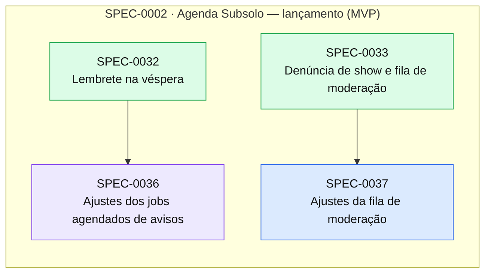

# Índice de Specs

> Gerado por `spec_graph.py index` em 2026-10-24 — não edite manualmente.

## Saúde

- Validação (G0): **1 erro(s), 20 aviso(s)** — rode `spec_graph.py validate`
- Specs: approved 1, in-progress 1, implemented 32
- Impedimentos: **0 aberto(s)**, 19 resolvido(s)

## Cobertura de Pilares

Perfil: **padrao**

| Pilar | Situação | Detalhe |
|---|---|---|
| Arquitetura e fronteiras | coberto | ADR-0001 |
| Estratégia de testes | coberto | ADR-0005 |
| Qualidade de código | coberto | ADR-0006 |
| Entrega contínua e ambientes | coberto | ADR-0004 |
| Fluxo de mudança | coberto | ADR-0007 |
| Segredos e dados sensíveis | coberto | ADR-0008 |
| Identidade e acesso | coberto | ADR-0003, ADR-0017 |
| Dependências e ciclo de vida da stack | coberto | ADR-0009 |
| Observabilidade | coberto | ADR-0010 |
| Resiliência e recuperação | coberto | ADR-0011 |
| Dados e migrações | coberto | ADR-0002 |
| Custo | coberto | ADR-0012 |

## Jornadas Críticas

| Jornada | Situação | Specs |
|---|---|---|
| Fã vê a agenda da cidade no celular | provada | SPEC-0008, SPEC-0008, SPEC-0009, SPEC-0010, SPEC-0011, SPEC-0024, SPEC-0025, SPEC-0025, SPEC-0028, SPEC-0028 |
| Produtor ou banda aprovados cadastram um show em menos de 2 minutos | provada | SPEC-0023, SPEC-0023 |
| Fã abre a página do show e compartilha com o flyer na prévia | provada | SPEC-0024, SPEC-0024, SPEC-0024, SPEC-0026, SPEC-0026 |
| Fã segue cidade, banda ou casa e recebe o aviso de show novo e o lembrete na véspera | provada | SPEC-0027, SPEC-0027, SPEC-0029, SPEC-0029, SPEC-0030, SPEC-0030, SPEC-0031, SPEC-0032 |
| Fã entra pelo link mágico no e-mail e sai | provada | SPEC-0016, SPEC-0016, SPEC-0016, SPEC-0020, SPEC-0020 |
| Admin cadastra cidade e estilo | provada | SPEC-0017, SPEC-0017 |
| Fã muda o nome, baixa os dados e exclui a conta | provada | SPEC-0019, SPEC-0019 |
| Fã pede perfil ou reivindica, admin aprova e o dono vira artista | provada | SPEC-0021, SPEC-0021 |
| Fã denuncia um show e o admin mantém ou oculta | provada | SPEC-0033 |

## Plano de Execução

**Em andamento:** SPEC-0036  
**Paradas por impedimento:** —  
**Próximo lote:** —

| Onda | Spec | Título | Tier/Tam. | Status | Prontidão | Observação |
|---|---|---|---|---|---|---|
| 1 | SPEC-0036 | Ajustes dos jobs agendados de avisos | lite/S | in-progress | 🔄 em andamento |  |
| 2 | SPEC-0037 | Ajustes da fila de moderação | lite/S | approved | ✅ pronta | saiu da onda 1: arquivos em comum com SPEC-0036 |

## Épicos

| Épico | Título | Status | Progresso |
|---|---|---|---|
| SPEC-0001 | Fundação do Subsolo | implemented | 10/10 implementadas |
| SPEC-0002 | Agenda Subsolo — lançamento (MVP) | approved | 22/24 implementadas |
| SPEC-0003 | Go-live: produção na VPS e serviços pagos | proposed | 0/0 implementadas |

## Grafo de Dependências

Seta contínua: depende da implementação. Seta tracejada: consome contrato.

## Todas as Specs

| ID | Título | Tier | Tipo | Status | Criada | Épico | Depende de | Consome contrato |
|---|---|---|---|---|---|---|---|---|
| [SPEC-0001](SPEC-0001-fundacao-do-subsolo.md) | Fundação do Subsolo | epic | foundation | implemented | 2026-10-13 | — | — | — |
| [SPEC-0002](SPEC-0002-agenda-subsolo-lancamento-mvp.md) | Agenda Subsolo — lançamento (MVP) | epic | feature | approved | 2026-10-13 | — | SPEC-0001 | — |
| [SPEC-0003](SPEC-0003-go-live-producao-na-vps-e-servicos-pagos.md) | Go-live: produção na VPS e serviços pagos | epic | foundation | proposed | 2026-10-13 | — | SPEC-0001 | — |
| [SPEC-0004](SPEC-0004-repositorio-e-ferramentas.md) | Repositório e ferramentas | full | foundation | implemented | 2026-10-13 | SPEC-0001 | — | — |
| [SPEC-0005](SPEC-0005-harness-de-testes.md) | Harness de testes | full | foundation | implemented | 2026-10-13 | SPEC-0001 | SPEC-0004 | — |
| [SPEC-0006](SPEC-0006-pipeline-de-ci-no-github-actions.md) | Pipeline de CI no GitHub Actions | full | foundation | implemented | 2026-10-13 | SPEC-0001 | SPEC-0004 | SPEC-0005@4 |
| [SPEC-0007](SPEC-0007-base-do-monolito-modular-com-aspire.md) | Base do monólito modular com Aspire | full | foundation | implemented | 2026-10-13 | SPEC-0001 | SPEC-0005 | — |
| [SPEC-0008](SPEC-0008-walking-skeleton-agenda-da-cidade.md) | Walking skeleton: agenda da cidade | full | foundation | implemented | 2026-10-13 | SPEC-0001 | SPEC-0006, SPEC-0007 | — |
| [SPEC-0009](SPEC-0009-observabilidade-base.md) | Observabilidade base | full | foundation | implemented | 2026-10-13 | SPEC-0001 | SPEC-0008 | — |
| [SPEC-0010](SPEC-0010-seguranca-base.md) | Segurança base | full | foundation | implemented | 2026-10-13 | SPEC-0001 | SPEC-0008 | — |
| [SPEC-0011](SPEC-0011-design-system-escuro-e-shell-do-app.md) | Design system escuro e shell do app | full | foundation | implemented | 2026-10-13 | SPEC-0001 | SPEC-0008 | — |
| [SPEC-0012](SPEC-0012-ajustes-menores-do-tooling-apontados-na-revisao-da-spec-0004.md) | Ajustes menores do tooling apontados na revisão da SPEC-0004 | lite | fix | implemented | 2026-10-13 | SPEC-0001 | — | — |
| [SPEC-0013](SPEC-0013-ajustes-menores-do-harness-e-do-ci-apontados-nas-revisoes-da.md) | Ajustes menores do harness e do CI apontados nas revisões das SPEC-0005 e SPEC-0006 | lite | fix | implemented | 2026-10-14 | SPEC-0001 | — | — |
| [SPEC-0014](SPEC-0014-modulo-users-conta-sessao-e-papeis.md) | Módulo Users: conta, sessão e papéis | full | feature | implemented | 2026-10-17 | SPEC-0002 | — | — |
| [SPEC-0015](SPEC-0015-titulo-da-pagina-presente-na-navegacao-no-cliente.md) | Título da página presente na navegação no cliente | lite | fix | implemented | 2026-10-17 | SPEC-0002 | — | — |
| [SPEC-0016](SPEC-0016-entrar-por-link-magico-no-e-mail.md) | Entrar por link mágico no e-mail | full | feature | implemented | 2026-10-17 | SPEC-0002 | SPEC-0014, SPEC-0018 | SPEC-0018@1 |
| [SPEC-0017](SPEC-0017-cidades-e-estilos-no-painel-do-admin.md) | Cidades e estilos no painel do admin | full | feature | implemented | 2026-10-17 | SPEC-0002 | SPEC-0014, SPEC-0016 | — |
| [SPEC-0018](SPEC-0018-modulo-notifications-e-mail-transacional-por-smtp.md) | Módulo Notifications: e-mail transacional por SMTP | full | feature | implemented | 2026-10-17 | SPEC-0002 | — | — |
| [SPEC-0019](SPEC-0019-minha-conta-nome-exportar-dados-e-excluir-conta.md) | Minha conta: nome, exportar dados e excluir conta | full | feature | implemented | 2026-10-17 | SPEC-0002 | SPEC-0014, SPEC-0016 | — |
| [SPEC-0020](SPEC-0020-entrar-com-google.md) | Entrar com Google | full | feature | implemented | 2026-10-17 | SPEC-0002 | SPEC-0016 | — |
| [SPEC-0021](SPEC-0021-perfis-pedido-aprovacao-pelo-admin-perfil-sem-dono-e-reivind.md) | Perfis: pedido, aprovação pelo admin, perfil sem dono e reivindicação | full | feature | implemented | 2026-10-17 | SPEC-0002 | SPEC-0017, SPEC-0019 | — |
| [SPEC-0022](SPEC-0022-upload-e-processamento-de-flyer.md) | Upload e processamento de flyer | full | feature | implemented | 2026-10-17 | SPEC-0002 | SPEC-0021 | — |
| [SPEC-0023](SPEC-0023-cadastro-de-show-edicao-cancelado-e-adiado.md) | Cadastro de show, edição, cancelado e adiado | full | feature | implemented | 2026-10-17 | SPEC-0002 | SPEC-0021, SPEC-0022 | — |
| [SPEC-0024](SPEC-0024-pagina-do-show-com-open-graph-e-compartilhar.md) | Página do show com Open Graph e compartilhar | full | feature | implemented | 2026-10-18 | SPEC-0002 | SPEC-0023 | — |
| [SPEC-0025](SPEC-0025-agenda-da-cidade-com-filtro-por-data-e-estilo.md) | Agenda da cidade com filtro por data e estilo | full | feature | implemented | 2026-10-18 | SPEC-0002 | SPEC-0023 | — |
| [SPEC-0026](SPEC-0026-perfil-publico-de-banda-casa-e-produtor.md) | Perfil público de banda, casa e produtor | full | feature | implemented | 2026-10-18 | SPEC-0002 | SPEC-0021, SPEC-0024 | — |
| [SPEC-0027](SPEC-0027-seguir-cidade-banda-e-casa.md) | Seguir cidade, banda e casa | full | feature | implemented | 2026-10-18 | SPEC-0002 | SPEC-0025, SPEC-0026 | — |
| [SPEC-0028](SPEC-0028-paginas-apoie-pix-privacidade-e-termos.md) | Páginas Apoie (Pix), privacidade e termos | full | feature | implemented | 2026-10-18 | SPEC-0002 | SPEC-0017 | — |
| [SPEC-0029](SPEC-0029-vou-com-contagem.md) | Vou com contagem | full | feature | implemented | 2026-10-18 | SPEC-0002 | SPEC-0027 | — |
| [SPEC-0030](SPEC-0030-inscricao-de-push-preferencias-de-aviso-e-canal-de-e-mail.md) | Inscrição de push, preferências de aviso e canal de e-mail | full | feature | implemented | 2026-10-18 | SPEC-0002 | SPEC-0019, SPEC-0027 | — |
| [SPEC-0031](SPEC-0031-aviso-de-show-novo-push-imediato-e-resumo-diario-por-e-mail.md) | Aviso de show novo (push imediato e resumo diário por e-mail) | full | feature | implemented | 2026-10-18 | SPEC-0002 | SPEC-0023, SPEC-0027, SPEC-0030 | — |
| [SPEC-0032](SPEC-0032-lembrete-na-vespera.md) | Lembrete na véspera | full | feature | implemented | 2026-10-18 | SPEC-0002 | SPEC-0029, SPEC-0030, SPEC-0031 | — |
| [SPEC-0033](SPEC-0033-denuncia-de-show-e-fila-de-moderacao.md) | Denúncia de show e fila de moderação | full | feature | implemented | 2026-10-18 | SPEC-0002 | SPEC-0019, SPEC-0021, SPEC-0024, SPEC-0031 | — |
| [SPEC-0034](SPEC-0034-atualizar-o-next-js-para-corrigir-avisos-de-seguranca.md) | Atualizar o Next.js para corrigir avisos de segurança | lite | fix | implemented | 2026-10-23 | SPEC-0002 | — | — |
| [SPEC-0035](SPEC-0035-ci-no-runner-ubuntu-26-04-runner-fixo-cache-do-playwright-po.md) | CI no runner Ubuntu 26.04: runner fixo, cache do Playwright por imagem e imagens Docker | lite | fix | implemented | 2026-10-23 | SPEC-0002 | — | — |
| [SPEC-0036](SPEC-0036-ajustes-dos-jobs-agendados-de-avisos.md) | Ajustes dos jobs agendados de avisos | lite | fix | in-progress | 2026-10-24 | SPEC-0002 | SPEC-0032 | — |
| [SPEC-0037](SPEC-0037-ajustes-da-fila-de-moderacao.md) | Ajustes da fila de moderação | lite | fix | approved | 2026-10-24 | SPEC-0002 | SPEC-0033 | — |

## ADRs

| ID | Título | Status | Garantido por (G3) |
|---|---|---|---|
| [ADR-0001](../adr/ADR-0001-monolito-modular-com-vertical-slices-em-net-10.md) | Monólito modular com vertical slices em .NET 10 | accepted | tests/Subsolo.ArchitectureTests (ArchUnitNET), rodando no CI |
| [ADR-0002](../adr/ADR-0002-postgresql-18-com-ef-core-10-e-schema-por-modulo.md) | PostgreSQL 18 com EF Core 10 e schema por módulo | accepted | teste de integração de migrações (Testcontainers) + teste de arquitetura de schema por DbContext |
| [ADR-0003](../adr/ADR-0003-identidade-propria-link-magico-por-e-mail-e-google.md) | Identidade própria: link mágico por e-mail e Google | accepted | testes de autorização (acesso negado) em cada spec + teste de arquitetura de endpoints sem política explícita |
| [ADR-0004](../adr/ADR-0004-aspire-docker-compose-e-caddy-na-vps-via-github-actions.md) | Aspire, Docker Compose e Caddy na VPS via GitHub Actions | accepted | pipeline GitHub Actions (deploy.yml) + comandos deploy_staging/deploy_production/smoke_test do sdd-config |
| [ADR-0005](../adr/ADR-0005-estrategia-de-testes.md) | Estratégia de testes | accepted | comandos test, test_integration, test_e2e, arch_test e coverage do sdd-config, no CI |
| [ADR-0006](../adr/ADR-0006-qualidade-de-codigo-automatica.md) | Qualidade de código automática | accepted | comando lint do sdd-config no CI (dotnet format + build com warnings como erro + eslint + tsc + semgrep) |
| [ADR-0007](../adr/ADR-0007-fluxo-de-mudanca-por-pull-request-no-github.md) | Fluxo de mudança por pull request no GitHub | accepted | proteção da branch main no GitHub + change_flow pr no sdd-config + job sdd (pr-check) obrigatório |
| [ADR-0008](../adr/ADR-0008-segredos-e-dados-pessoais-lgpd.md) | Segredos e dados pessoais (LGPD) | accepted | gitleaks no CI e no pre-commit (security_scan) + teste de mascaramento de logs |
| [ADR-0009](../adr/ADR-0009-dependencias-e-ciclo-de-vida-da-stack.md) | Dependências e ciclo de vida da stack | accepted | security_scan no CI (dotnet list package --vulnerable + pnpm audit + gitleaks) + Dependabot |
| [ADR-0010](../adr/ADR-0010-observabilidade-com-opentelemetry-e-seq.md) | Observabilidade com OpenTelemetry e Seq | accepted | ServiceDefaults do Aspire em todos os serviços + teste de integração do health check + monitor externo |
| [ADR-0011](../adr/ADR-0011-backup-e-recuperacao-na-vps.md) | Backup e recuperação na VPS | accepted | job de restauração automática mensal com resultado no Seq + testes de integração de timeout e idempotência |
| [ADR-0012](../adr/ADR-0012-custo-de-operacao.md) | Custo de operação | accepted | revisão no G4 (nenhuma dependência paga sem ADR) + estimativa revisada e aprovada no épico de go-live |
| [ADR-0013](../adr/ADR-0013-front-end-em-next-js-16-com-pwa.md) | Front-end em Next.js 16 com PWA | accepted | E2E de prévia Open Graph e de instalação/push (Playwright) + compilação do cliente OpenAPI no CI |
| [ADR-0014](../adr/ADR-0014-avisos-por-web-push-e-e-mail.md) | Avisos por Web Push e e-mail | accepted | teste de arquitetura (canais só implementam INotificationChannel no módulo Notifications) + testes de integração com Mailpit e servidor de push falso |
| [ADR-0015](../adr/ADR-0015-armazenamento-e-processamento-de-flyers.md) | Armazenamento e processamento de flyers | accepted | teste de arquitetura (só Common.Infrastructure referencia NetVips e o sistema de arquivos) + testes de integração de upload |
| [ADR-0016](../adr/ADR-0016-status-http-das-paginas-ssr-via-proxy-do-next-js.md) | Status HTTP das páginas SSR via proxy do Next.js | accepted | E2E-01 (404 da cidade inexistente) e IT-04 (503 com a API fora) da SPEC-0008, rodando em todo PR |
| [ADR-0017](../adr/ADR-0017-csp-com-nonce-e-paginas-renderizadas-por-requisicao.md) | CSP com nonce e páginas renderizadas por requisição | accepted | UT-02, IT-05 e E2E-01 da SPEC-0010 (CSP com nonce presente e nenhuma violação de CSP no navegador em `/`, na agenda e na página de não encontrado) |
